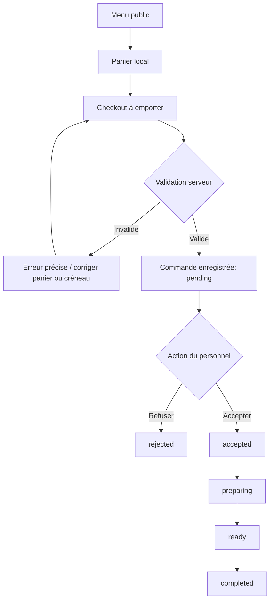

# 06 — Parcours commande et machine à états

## Flux MVP

## Statuts autorisés
- `pending` → `accepted` ou `rejected` ou `cancelled` (annulation client uniquement si politique validée, sinon admin).
- `accepted` → `preparing` ou `cancelled` (motif obligatoire).
- `preparing` → `ready` ou `cancelled` (motif obligatoire, policy).
- `ready` → `completed` ; annulation exceptionnelle soumise à validation métier.
- `completed`, `rejected`, `cancelled` = terminaux. Aucun retour arrière automatique.

Le rôle `staff` peut changer des statuts opérationnels ; `admin` peut aussi gérer la configuration. Enregistrer qui a fait chaque changement. Interdire les transitions illégales **dans le serveur**, pas seulement dans les boutons.

## Paiement
- MVP : `payment_method=pay_at_pickup`, `payment_status=unpaid` lors du placement.
- Le personnel peut marquer `paid` uniquement selon procédure métier approuvée ; ne pas confondre `completed` avec `paid` automatiquement si non validé.
- Paiement en ligne : futur module avec fournisseur agréé, vérification **webhook serveur**, idempotence, rapprochement et gestion annulation/remboursement. Aucune carte bancaire côté application.

## Disponibilité
- Commandes ouvertes ? Produit disponible ? Créneau proposé dans horaires actifs ? Délai de préparation respecté ? Capacité restante ?
- Tous vérifiés **en transaction au submit**, même si le frontend les a déjà vérifiés.
- Si boutique pause/ferme pendant checkout, renvoyer erreur actionable.
- `Africa/Casablanca` pour créneaux ; convertir en UTC côté persistance. Tester DST/fuseaux et minuit.
- Si pas d'horaires fiables configurés, `ordering_enabled=false` en production.

## Expérience après commande
- Générer un `public_number` humain et un lien privé `/order/[trackingToken]` fort et imprévisible.
- Afficher numéro, créneau, prix, statut, message générique ; ne pas divulguer numéro de téléphone ou adresse.
- Le lien de suivi peut être partagé : traiter son token comme secret de capacité ; noindex, no-store, rate limit.
- Actualisation par rafraîchissement/polling raisonnable plutôt que WebSocket obligatoire pour MVP.

## Erreurs critiques à traiter
- Double clic / retry réseau → **même commande**, pas deux.
- Prix modifié → nouveau récapitulatif et consentement du client.
- Produit épuisé → message sur la ligne correspondante.
- Créneau complet → alternatives disponibles.
- Deux membres du personnel cliquent simultanément → transition conditionnelle et `409`.
- Coupure de réseau après commit → réessai idempotent retourne numéro d'origine.
- Notifications en panne → commandes toujours visibles au dashboard.

## Opérations quotidiennes
Avant ouverture : vérifier horaires, menu, pricing, que l'équipe surveille le tableau admin. Pause commandes en un clic en cas de surcharge ; réouverture uniquement volontaire. Plan de secours si réseau coupé (vente physique sans nouvelles commandes web).
